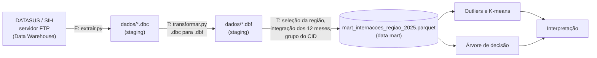

# Internações SUS — região de Aiuruoca (MG)

Pipeline de dados com as internações hospitalares do SUS na região de Aiuruoca, no Sul de Minas. Projeto da disciplina de Mineração de Dados do curso de Sistemas de Informação, feito com dados públicos reais.

## O problema

O hospital de Aiuruoca atende muita gente de fora da cidade. Todo mundo aqui sabe disso, mas ninguém tinha o número.

Quis responder duas perguntas:

1. **De onde vêm os pacientes do hospital de Aiuruoca?**
2. **Do que os moradores da região são internados?**

## O que os dados mostraram até agora

Em 2025, o hospital de Aiuruoca (CNES 2760681) teve **2.200 internações pelo SUS**. Só **616 (28%)** foram de moradores de Aiuruoca. As outras vieram de mais de 40 cidades, quase todas da região.

As que mais mandaram pacientes, depois de Aiuruoca: Carvalhos (317), Liberdade (226), Seritinga (188), Serranos (184) e Bocaina de Minas (171).

## Arquitetura



- **Fonte (Data Warehouse):** o SIH/SUS, publicado pelo DATASUS. Cada linha é uma AIH (Autorização de Internação Hospitalar), ou seja, uma internação paga pelo SUS.
- **Staging:** a pasta `dados/`, com os arquivos brutos de Minas Gerais, um por mês.
- **ETL:** os scripts `extrair.py` e `transformar.py`.
- **Data mart:** um arquivo Parquet só com a região e o ano de 2025, pronto para as análises. São 18.862 internações de moradores das 21 cidades, com 115 colunas; 2.163 delas foram no hospital de Aiuruoca.

## Decisões do projeto

**Ano: 2025.** É o ano completo mais recente. Os meses de 2026 ainda recebem correções dos hospitais.

**Região: cidades com 5 ou mais internações no hospital de Aiuruoca em 2025.** São 21 cidades, que somam 2.163 das 2.200 internações (98% do movimento do hospital). O mínimo tira os casos isolados, como turistas internados de passagem.

Cidades da região: Aiuruoca, Carvalhos, Liberdade, Seritinga, Serranos, Bocaina de Minas, Alagoa, Arantina, Bom Jardim de Minas, Jesuânia, Itamonte, Passa-Vinte, Santa Rita do Jacutinga, Caxambu, São Vicente de Minas, Andrelândia, Minduri, Cruzília, Baependi, Lambari e Passa Quatro.

**O mart guarda todas as internações dos moradores dessas cidades, em qualquer hospital de Minas.** Assim ele responde as duas perguntas: o que o hospital de Aiuruoca atende (filtrando pelo município do hospital) e do que os moradores de cada cidade são internados (o mart inteiro).

## Como rodar

```bash
python -m venv venv
venv\Scripts\activate
pip install pandas dbfread pyreaddbc pyarrow

python extrair.py        # baixa os 12 meses de 2025 do servidor do SUS
python transformar.py    # converte, seleciona, integra e salva o data mart
```

Os dois scripts podem rodar mais de uma vez sem problema: arquivos que já existem são pulados.

## Sobre os dados

- Fonte: SIH/SUS, `ftp://ftp.datasus.gov.br/dissemin/publicos/SIHSUS/200801_/Dados/`
- Nome dos arquivos: `RD` (AIH reduzida) + `MG` + ano com 2 dígitos + mês com 2 dígitos. Exemplo: `RDMG2501.dbc` é janeiro de 2025.
- Formato: `.dbc`, um `.dbf` (dBase) compactado pelo DATASUS.
- Código do município: 6 dígitos (o código do IBGE sem o dígito verificador). Aiuruoca é `310120`.
- Os dados são públicos e anônimos. Os arquivos não vão para o repositório (estão no `.gitignore`).

## Limitações

- **Uma linha é uma internação, não uma pessoa.** O mesmo paciente internado duas vezes conta duas.
- **Só internações pagas pelo SUS.** Particular e convênio não aparecem.
- **Só hospitais de Minas.** Um morador da região internado em outro estado não entra.
- **O critério da região é simples.** Cidades maiores com hospital próprio (Lambari, Caxambu, Baependi, Passa Quatro) entram com todas as internações dos moradores, mesmo mandando poucos pacientes para Aiuruoca. Um critério melhor mediria quanto cada cidade depende do hospital.
- **`CID_LETRA` é uma aproximação** do capítulo da CID-10: alguns capítulos dividem a mesma letra.

## Próximos passos

- [ ] Detecção de outliers em dias de internação e valor (quartis / IQR)
- [ ] K-means agrupando as cidades pelo perfil de internação
- [ ] Árvore de decisão para óbito na internação
- [ ] Juntar os nomes dos municípios e as descrições da CID-10

## Progresso

| Etapa | Unidade | O que foi feito | Resultado | Status |
|---|---|---|---|---|
| Extração | I | `extrair.py` baixa os 12 meses de 2025 do DATASUS | 12 arquivos `.dbc` de MG | ✅ |
| Pré-processamento | I | `transformar.py` converte `.dbc` em `.dbf` | 12 arquivos `.dbf` | ✅ |
| Seleção da região | I | Cidades com 5+ internações no hospital de Aiuruoca | 21 cidades (98% do movimento) | ✅ |
| Integração e carga | I | Junta os 12 meses e salva o data mart | 18.862 internações, 115 colunas | ✅ |
| Validação | I | Totais mensais conferidos com o TabNet | Bateu mês a mês (2.200) | ✅ |

| Outliers dos meses | II | Quartis nos 12 meses do hospital | Nenhum mês fora do padrão | ✅ |
| Outliers de dias | II | Quartis em `DIAS_PERM` | Limite 11 dias; 1.189 internações longas (6,3%), mais respiratórias; as mais longas em Juiz de Fora e BH | ✅ |
| Outliers no valor pago (`VAL_TOT`) | II | ✅ | Limite de R$ 2.138; 2.956 internações caras (15,7%), coração no topo e câncer em segundo; caro não é o mesmo que longo |
| Perfil das cidades | II | Porcentagem de cada grupo do CID por cidade | — | ✅ | Tabela de 21 cidades × 22 grupos do CID em porcentagem; destaques: Santa Rita do Jacutinga 31% respiratório, Jesuânia 15,9% partos |
| K-means | II | Escolher o K pelo joelho do SSE e agrupar as 21 cidades | — | ✅ | 
| K-means e escolha do K pelo joelho (`clusters.py`) | II / V | ✅ | Joelho entre K = 4 e 5; escolhido K = 5 por separar melhor. Dois perfis (respiratório e circulatório) e três cidades atípicas |